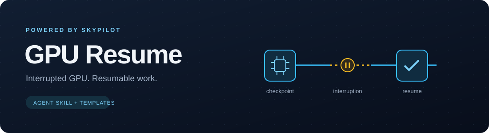

<p align="center">
  
</p>

<p align="center"><a href="README.md">简体中文</a> · <strong>English</strong></p>

<p align="center">
  <a href="https://github.com/Protocol-zero-0/gpu-resume-skill/actions/workflows/checks.yml"></a>
  <a href="LICENSE"></a>
</p>

# GPU Resume · Interrupted GPU. Resumable work.

**A GPU checkpoint and recovery workflow for AI agents, powered by SkyPilot.**

A long experiment should outlive the machine running it.
GPU Resume connects application checkpoints, persistent storage, and resource rescheduling: when a GPU is reclaimed, the job waits for available resources and resumes from saved progress.

For LLM fine-tuning, model evaluation, and batch inference on Spot GPUs and temporary GPU capacity.

## From restarting machines to recovering work

SkyPilot handles resource scheduling and Managed Jobs recovery. The application tracks how far it has progressed.
GPU Resume gives agents a workflow across both layers: inspect the code, add the recovery path, verify interruption behavior, then submit the job.

```text
Workload → Agent + GPU Resume → Resumable job → SkyPilot
                                   │             │
                           checkpoints / shards  GPU A
                                   │             ↓ preemption
                           persistent storage → GPU B
                                               restore & resume
```

| Workload | Recovery path |
| --- | --- |
| LLM fine-tuning / model training | Restore model, optimizer, RNG, and data position |
| Model evaluation / batch inference | Commit independent shards; skip completed work on retry |
| Experiment batches | Keep separate state for each job and continue on available resources |

**State lives beyond the machine. Recovery belongs to the workload.** Checkpoints live outside the GPU host; the save interval determines the amount of work that may need repeating after an interruption.

## Bring your agent

The workflow is a Markdown skill; operations use the `gpu-resume` CLI. Neither interface is tied to a particular agent.
Agents that can read instructions and execute terminal commands can load [SKILL.md](skills/gpu-resume/SKILL.md). Custom agents can expose the CLI through tool calling.
The installer provides entries in `~/.agents/skills` and `~/.claude/skills`; other runtimes can use their own skill-loading mechanism.

Give your agent the code and a recovery requirement:

> Prepare this evaluation as a resumable GPU job with gpu-resume. Skip completed shards and allow up to two minutes of lost progress. Adapt and verify recovery first, then generate the SkyPilot configuration.

## Quick start

Requires Git, Python 3.12+, and [uv](https://docs.astral.sh/uv/getting-started/installation/).

```bash
git clone https://github.com/Protocol-zero-0/gpu-resume-skill.git ~/work/gpu-resume-skill
cd ~/work/gpu-resume-skill
python3 scripts/install.py
gpu-resume self-test
```

The self-test terminates a local example process, restores its checkpoint, and verifies the completed computation.
Keep the checkout in place, add `~/.local/bin` to `PATH`, and load the skills in a new agent session.

To submit a workload, configure a [remote SkyPilot service](https://docs.skypilot.ai/en/stable/reference/api-server/api-server.html), GPU resources, and independent persistent storage:

```bash
gpu-resume connect https://YOUR_API_SERVER
gpu-resume doctor
gpu-resume submit path/to/task.yaml
gpu-resume queue
gpu-resume logs JOB_ID --tail 100 --no-follow
```

Submitted jobs run under the remote service beyond the lifetime of the agent session. Without a connected service, `doctor` reports `setup_required`.

## Engineering and documentation

- [Recovery contract and verification scope](docs/verification.md#english): checkpoints, idempotent commits, and first-deployment validation.
- [Spot GPU template](skills/gpu-resume/templates/spot-demo.yaml) · [SSH pool template](skills/gpu-resume/templates/ssh-demo.yaml): replace resource and storage settings before use.
- [SkyPilot](https://github.com/skypilot-org/skypilot) · [Official agent skill](https://github.com/skypilot-org/skypilot/tree/v0.14.0/agent/skills/skypilot): upstream resource orchestration.

The client and upstream skill are [version-pinned](skills/gpu-resume/upstream.lock.json). Weekly checks report new releases; upgrades follow validation. Run `gpu-resume check-updates` for a manual check.
