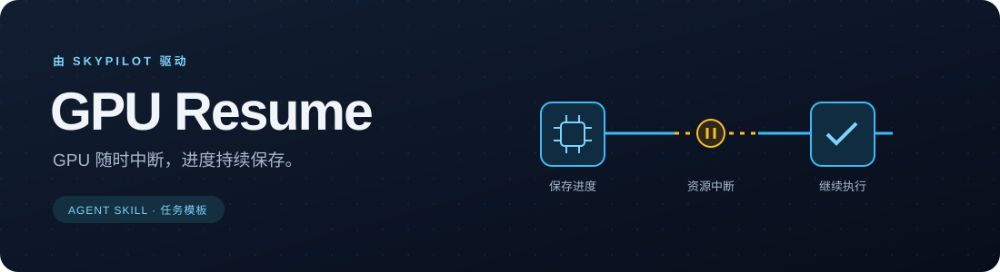

<p align="center">
  
</p>

<p align="center"><strong>简体中文</strong> · <a href="README.en.md">English</a></p>

<p align="center">
  <a href="https://github.com/Protocol-zero-0/gpu-resume-skill/actions/workflows/checks.yml"></a>
  
  <a href="LICENSE"></a>
</p>

<p align="center"><strong>让 GPU 任务能够中断、等待资源，再接着跑。</strong><br>
基于 SkyPilot，用一个轻量 skill 补齐任务的进度保存与恢复流程。</p>

## 工作方式

| 资源恢复 | 进度恢复 | 统一调用入口 |
| --- | --- | --- |
| GPU 被回收后，SkyPilot 寻找可用资源并重新启动托管任务。 | 任务读取 checkpoint（检查点），或跳过已完成的数据分片。 | 不同服务器上的 agent 连接同一个远程 API 服务。 |

仓库包含一个轻量 skill、两类任务模板、安装脚本和 checkpoint 示例。
安装时还会接入固定版本的 SkyPilot 官方 skill，调度能力直接复用上游。
安装过程不会创建云资源，也不会启动本地控制服务。

## 安装

需要 Git、Python 3.12+ 和 [uv](https://docs.astral.sh/uv/getting-started/installation/)。

```bash
git clone https://github.com/Protocol-zero-0/gpu-resume-skill.git ~/work/gpu-resume-skill
cd ~/work/gpu-resume-skill
python3 scripts/install.py
gpu-resume self-test
gpu-resume doctor
```

安装脚本会固定 SkyPilot 客户端版本，并把两个 skill 链接到
`~/.agents/skills` 和 `~/.claude/skills`。安装后请保留仓库所在目录；
如果找不到命令，将 `~/.local/bin` 加入 `PATH`。skill 会在下一轮对话或新会话中被发现。
遇到已有的同名文件时，安装脚本会保留它们并停止覆盖。

**还没有 GPU，也可以先安装。** `self-test` 在本地 CPU 上验证恢复流程；
连接可用的远程 API 服务之前，`doctor` 会显示 `setup_required`，退出码为 2。

## 使用

直接告诉 agent：

> 用 gpu-resume 把这个任务接到可中断 GPU 上。优先使用任务框架已有的 checkpoint 能力，
> 连接共享服务，说明每次中断最多需要重算多少工作。

已有共享的 SkyPilot 服务后，也可以使用命令行：

```bash
gpu-resume connect https://YOUR_API_SERVER
gpu-resume doctor
gpu-resume submit path/to/task.yaml
gpu-resume queue
gpu-resume logs JOB_ID --tail 100 --no-follow
```

从 [Spot 模板](skills/gpu-resume/templates/spot-demo.yaml)或
[SSH 资源池模板](skills/gpu-resume/templates/ssh-demo.yaml)开始，提交前替换示例中的
GPU 型号、存储前缀和资源池名称。示例运行计数器，用于验证进度保存与恢复；
真实训练应使用框架自身的保存、加载接口，包含 optimizer、随机数状态和数据读取位置。

**checkpoint 必须保存在临时 GPU 机器之外。** 示例支持持久目录，或已有 S3 bucket
中的独立任务前缀。使用本地目录做演示，不代表 GPU 实例上的临时磁盘能保留数据。
远端任务需要具备存储访问权限；安装脚本不会创建 bucket。
示例中每个前缀只允许一个写入者，不同任务使用不同前缀。

## 已验证的范围

`gpu-resume self-test` 会在第 27 步强制杀死一个真实 CPU 进程，新进程从已保存的
第 20 步继续，直到结果正确完成；完成后再重试一次，检查最终结果是否保持一致。

这验证了示例在本地的 checkpoint 逻辑。GPU 更换、远程调度服务恢复、S3 连通性，
以及具体训练框架的状态是否保存完整，仍需在实际基础设施上做一次中断恢复验证。

## 跟随上游更新

```bash
gpu-resume check-updates
```

GitHub 工作流每周检查上游发布版本，并在运行摘要中记录结果，不会自动修改安装。
升级时先评估新版本，更新[版本记录](skills/gpu-resume/upstream.lock.json)，
验证客户端与服务端兼容性、任务恢复能力，再切换版本。
保留前一份版本记录和部署状态以便回退，避免直接把上游主分支拉进正在运行的环境。

---

基于 [SkyPilot](https://github.com/skypilot-org/skypilot) 及其
[官方 agent skill](https://github.com/skypilot-org/skypilot/tree/v0.14.0/agent/skills/skypilot)。
相关文档：[托管任务与恢复](https://docs.skypilot.ai/en/v0.14.0/examples/managed-jobs.html) ·
[API 服务部署](https://docs.skypilot.ai/en/stable/reference/api-server/api-server.html)。
