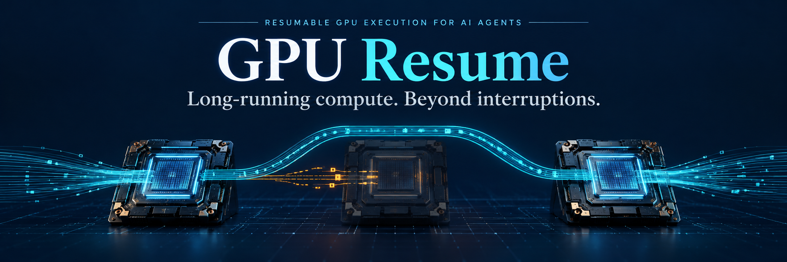
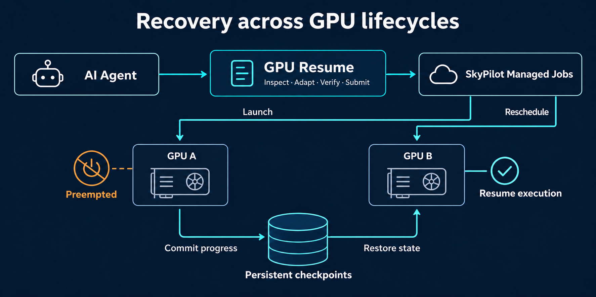

<p align="center">
  
</p>

<p align="center"><strong>简体中文</strong> · <a href="README.en.md">English</a></p>

<p align="center">
  <a href="https://github.com/Protocol-zero-0/gpu-resume-skill/actions/workflows/checks.yml"></a>
  <a href="LICENSE"></a>
</p>

# GPU Resume · 让长任务跨越 GPU 中断

**面向 AI Agent 的 GPU 任务恢复层，基于 SkyPilot。**

一次长实验，不该随着一台机器的退出而从头开始。
GPU Resume 将应用的 checkpoint、持久存储与资源重新调度连接起来：GPU 被回收后，等待可用资源，从已保存的进度继续。

适用于 LLM 微调、模型评测与批量推理，让 Spot GPU 和临时 GPU 成为长任务可以使用的算力。

## 从重启机器，到恢复任务

SkyPilot 负责资源调度与 Managed Jobs 恢复；应用负责知道自己算到了哪里。
GPU Resume 连接应用状态与算力调度，由 Agent 完成恢复适配：检查代码、补齐恢复路径、验证中断行为，再提交任务。

<p align="center">
  
</p>

| 任务 | 恢复方式 |
| --- | --- |
| LLM 微调 / 模型训练 | 恢复模型、优化器、随机数与数据位置 |
| 模型评测 / 批量推理 | 按独立分片提交结果，重试时跳过已完成部分 |
| 多组实验 | 为各任务保存独立状态，在可用资源上继续执行 |

**状态独立于机器，恢复成为任务的一部分。** checkpoint 保存在 GPU 主机之外；保存间隔决定中断后需要重算的范围。

## 接入你的 Agent

恢复契约与操作指令以 Markdown skill 提供，操作通过 `gpu-resume` CLI 完成，不绑定特定 Agent。
支持读取指令和调用终端的 Agent，可加载 [SKILL.md](skills/gpu-resume/SKILL.md)；自建 Agent 可将 CLI 封装为工具调用。
安装器提供 `~/.agents/skills` 和 `~/.claude/skills` 入口，其他运行时按其技能加载方式接入。

把代码和恢复要求交给 Agent：

> 把这个评测任务准备成可恢复的 GPU 任务。使用 gpu-resume，已完成分片不要重跑，允许丢失最近两分钟的进度。先适配并验证恢复，再生成 SkyPilot 配置。

## 快速开始

需要 Git、Python 3.12+ 和 [uv](https://docs.astral.sh/uv/getting-started/installation/)。

```bash
git clone https://github.com/Protocol-zero-0/gpu-resume-skill.git ~/work/gpu-resume-skill
cd ~/work/gpu-resume-skill
python3 scripts/install.py
gpu-resume self-test
```

`self-test` 演示本地示例进程被终止后，从 checkpoint 恢复并完成计算。
保留仓库目录，将 `~/.local/bin` 加入 `PATH`，在新 Agent 会话中加载技能。

提交实际任务前，准备[远程 SkyPilot 服务](https://docs.skypilot.ai/en/stable/reference/api-server/api-server.html)、GPU 资源与独立持久存储：

```bash
gpu-resume connect https://YOUR_API_SERVER
gpu-resume doctor
gpu-resume submit path/to/task.yaml
gpu-resume queue
gpu-resume logs JOB_ID --tail 100 --no-follow
```

已提交任务由远程服务托管，Agent 会话结束后仍可执行。未连接服务时，`doctor` 返回 `setup_required`。

## 工程与文档

- [恢复契约与验证范围](docs/verification.md)：checkpoint、幂等提交与首次接入验证。
- [Spot GPU 模板](skills/gpu-resume/templates/spot-demo.yaml) · [SSH 资源池模板](skills/gpu-resume/templates/ssh-demo.yaml)：替换资源与存储配置后使用。
- [SkyPilot](https://github.com/skypilot-org/skypilot) · [官方 Agent skill](https://github.com/skypilot-org/skypilot/tree/v0.14.0/agent/skills/skypilot)：复用上游调度能力。

客户端与上游 skill [固定版本](skills/gpu-resume/upstream.lock.json)。每周检查更新，验证后升级；手动检查用 `gpu-resume check-updates`。
